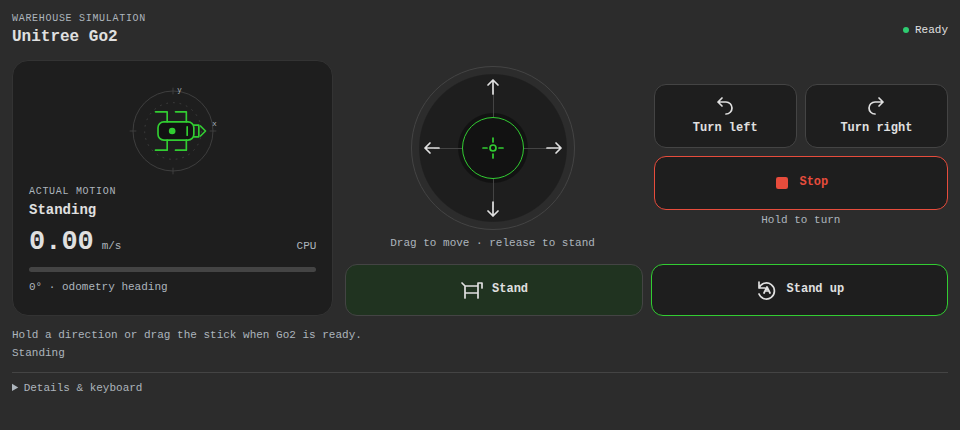

# Go2 Control for Robo-Boy

Drive the Unitree Go2 simulation with a touch joystick, direction buttons, or keyboard. See measured motion and request learned standing or recovery from a Robo-Boy workspace tile.

This independently installed external panel uses Robo-Boy's sandbox and brokered ROS API.
It requests only the exact ROS resources declared in [roboboy.panel.json](roboboy.panel.json).



Panel preview with sample telemetry. This is the released interface, not a live robot session.
See [preview provenance](docs/images/README.md).

## Install and run

Use a Robo-Boy deployment with Panel API v2 and the official Panel Inventory configured.
See [Robo-Boy's installation guide](https://github.com/tessel-la/robo-boy/blob/main/docs/external-panels.md#remote-inventories-and-private-panels)
for the authenticated Panel Manager setup.

1. Start the [Go2 simulator](https://github.com/tessel-la/genesis-mobile-sim) using its CPU quickstart and the same ROS discovery settings as Robo-Boy. Run one simulator per ROS domain.
2. Open **Manage installations…**, browse the official inventory, select **Go2 Control**, review its ROS permissions, and apply the installation.
3. Connect Robo-Boy to the simulator's ROS stack and add **Go2 Control** from the workspace panel menu.
4. Request control from Robo-Boy's control menu before driving.

Installing the panel does not start the simulator. Published panel users do not need Node.js,
this source checkout, or the SDK. Releases must be published and registered before this panel
appears in the official inventory; maintainers follow [the release guide](docs/releasing.md).

## Develop

Use Node.js 22 or later and npm. No sibling source checkout is needed to build: the type-only
SDK is pinned to its public GitHub release and dependencies are locked.

```bash
git clone https://github.com/tessel-la/robo-boy-go2-control-panel.git
cd robo-boy-go2-control-panel
npm ci
npm run release:prepare
```

This runs typecheck, tests, build, SRI generation, and artifact validation. After source changes,
rebuild and update SRI before installing. Use the local source configuration with a sibling
Robo-Boy checkout for frontend development:

```bash
cd ../robo-boy
npm run dev:panels -- --config ../robo-boy-go2-control-panel/examples/panel-sources.json
```

For Docker, use `examples/docker-compose.panel.yml` with Robo-Boy's local panel overlay;
see [custom panels](https://github.com/tessel-la/robo-boy/blob/main/docs/custom-panels.md).
Keep the manager authenticated and preserve other selections in an existing deployment.

## How it fits

The panel owns its UI and command lifecycle. The simulator owns physics, policies, watchdogs,
and ROS services. Robo-Boy owns the sandbox, control gateway, installation, and workspace.
[AGENTS.md](AGENTS.md) and [CONTRIBUTING.md](CONTRIBUTING.md) describe source contributions.

## Controls

- Drag the center of the joystick to walk and move sideways with proportional speed
- Hold a turn button with a second finger to move and turn together
- Hold the forward/backward buttons or W/S: ±0.2 m/s
- Hold the sideways buttons or Q/E: ±0.15 m/s
- Hold the turn buttons or A/D: ±0.4 rad/s
- **Stand** ends walking and selects the recovery policy's standing behavior
- **Stand up** runs the published recovery policy and waits for a stable stance
- Arrow keys walk forward/backward and turn; Escape stops all held inputs
- Space stops when the tile itself has focus; native action buttons keep their Space activation
- Enter or Space holds a focused direction button; release the key to stop

Focus the tile before using keys. Combined inputs stay within the same speed limits;
diagonal translation uses a bounded ellipse. The touch joystick has a radial dead zone.
Each finger or key releases independently, and **Stop** clears every input.
Commands repeat at 20 Hz while held. Release,
pointer cancellation, focus loss, hidden tiles, disconnected ROS, changed connections,
tile resize, stale odometry or motion status, and removal end the repeating command. The simulator also expires
commands after 0.5 s of wall time. Reconnection never resumes a held direction.

Controls become available only after `/robot_description` identifies the Go2 model
and fresh `/odom` data uses the `base` frame. Fresh `/go2/status` data must confirm
that walking is available. During recovery or a fall, walking is disabled; an explicit
recovery request remains available when the robot is fallen. Failed subscriptions expose **Retry telemetry**.
Hidden tiles release subscriptions and timers. The layout follows the host viewport
and theme, including narrow tiles.

The heading graphic and speed meter use measured odometry rather than requested
commands. They clear when telemetry becomes unavailable. The heading axes are the
simulator's odometry x/y axes; the graphic is not an occupancy map or a compass.

## Permissions

The only capability is `ros`:

| Access | Exact topic | Purpose |
| --- | --- | --- |
| Subscribe | `/robot_description` | Identify the existing Go2 before enabling motion |
| Subscribe | `/odom` | Read live pose/velocity and detect stale telemetry |
| Subscribe | `/go2/status` | Read execution state, available motions, and compute backend |
| Publish | `/go2/motion_cmd` | Request standing or learned recovery |
| Publish | `/cmd_vel` | Send bounded walking/turning commands and stop |

The panel requests no discovery, services, storage, network, or device access.

## Limitations

Cancel navigation before manual control. **Stop** sends zero velocity; it does not cancel
Nav2 goals or act as a hardware emergency stop. The two reused policies provide walking, standing, and recovery. Sit, jump, and
hardware control are outside this panel's contract. Recovery can fail near obstacles;
the simulator applies a 12 s simulated timeout and leaves the robot in damping.
Use Robo-Boy's existing Camera and 3D view panels for images and lidar. Navigation
actions stay in Robo-Boy's native action/behavior-tree tools because Panel API v2 has no actions.

## License

MIT; see [LICENSE](LICENSE). The SDK is a separate type-only dependency with its own notice.
